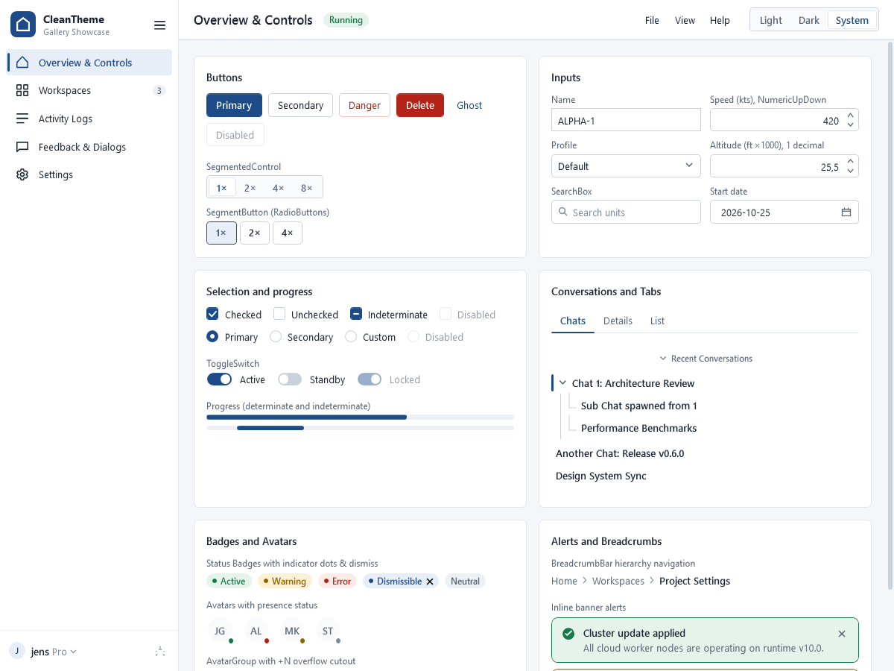
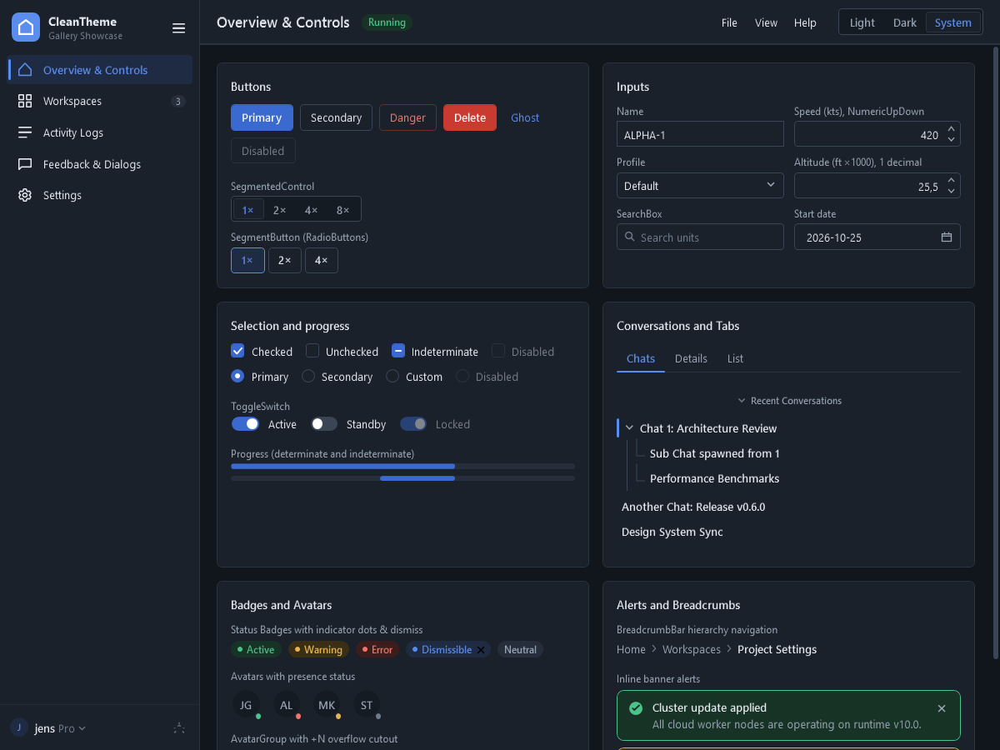
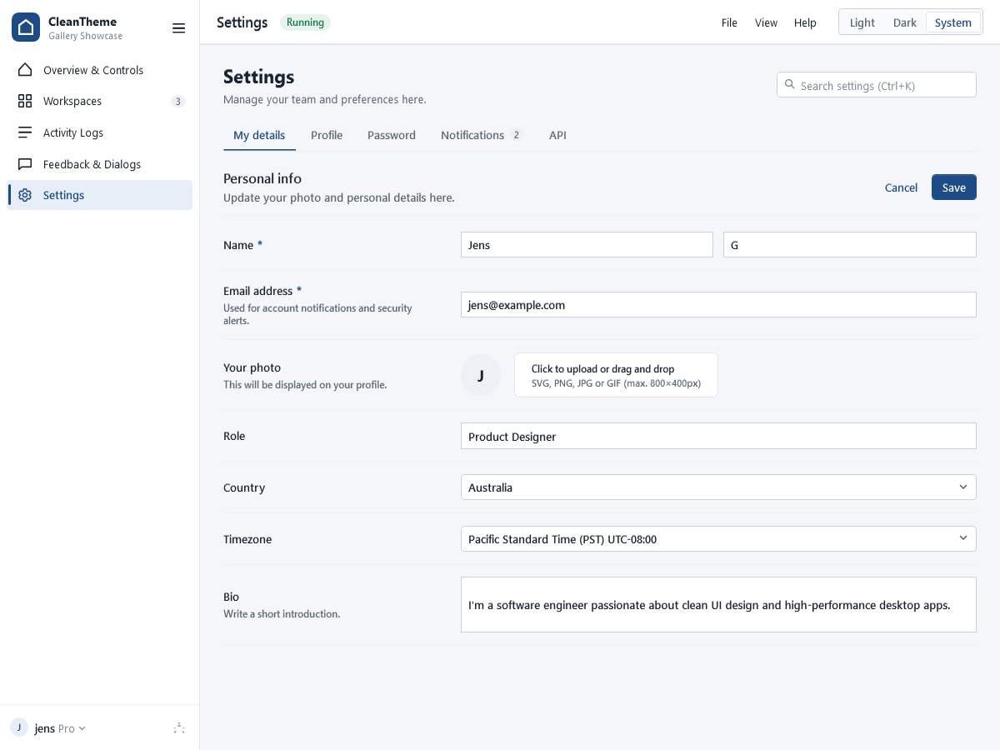
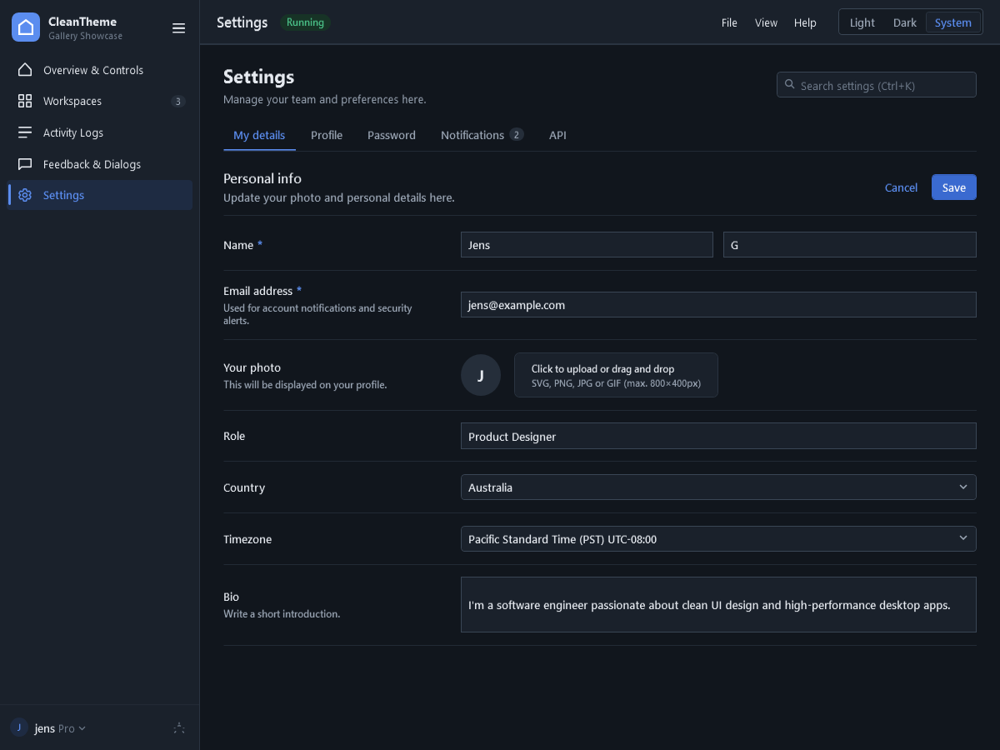
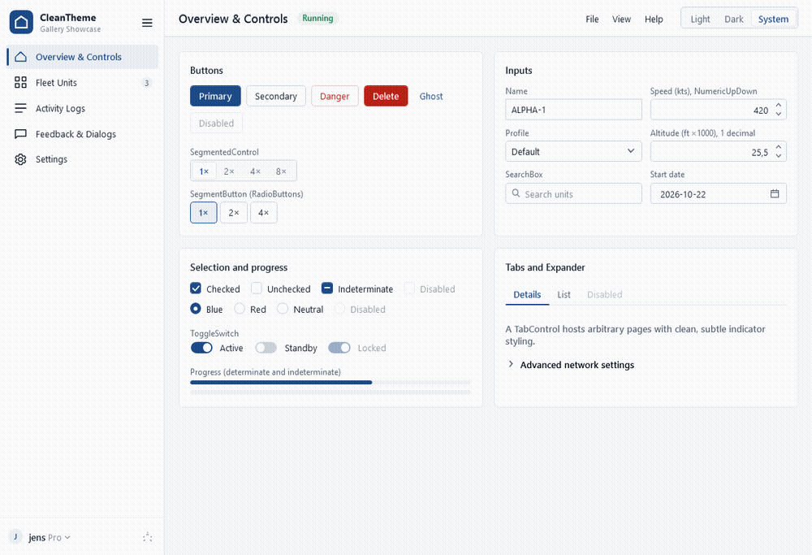
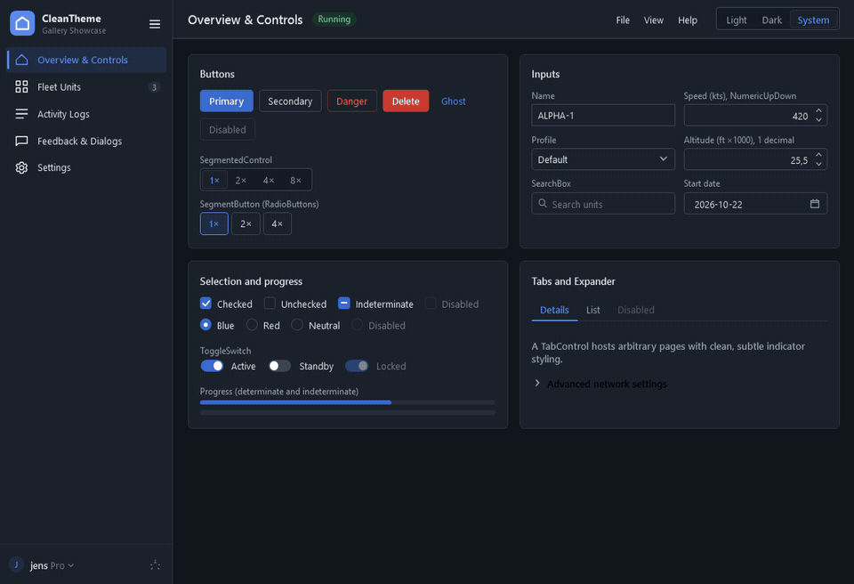
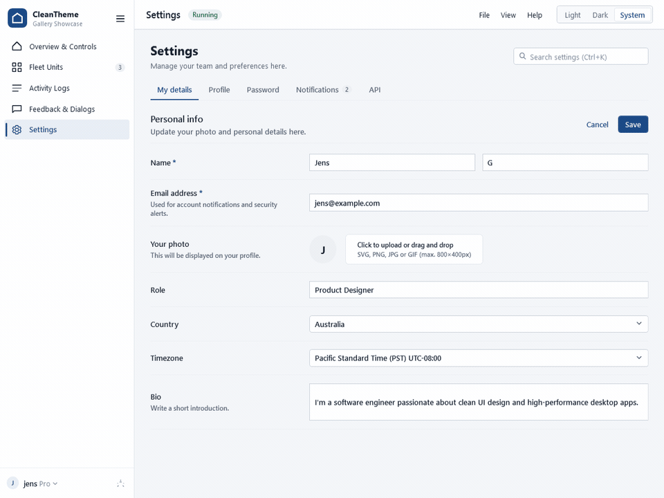
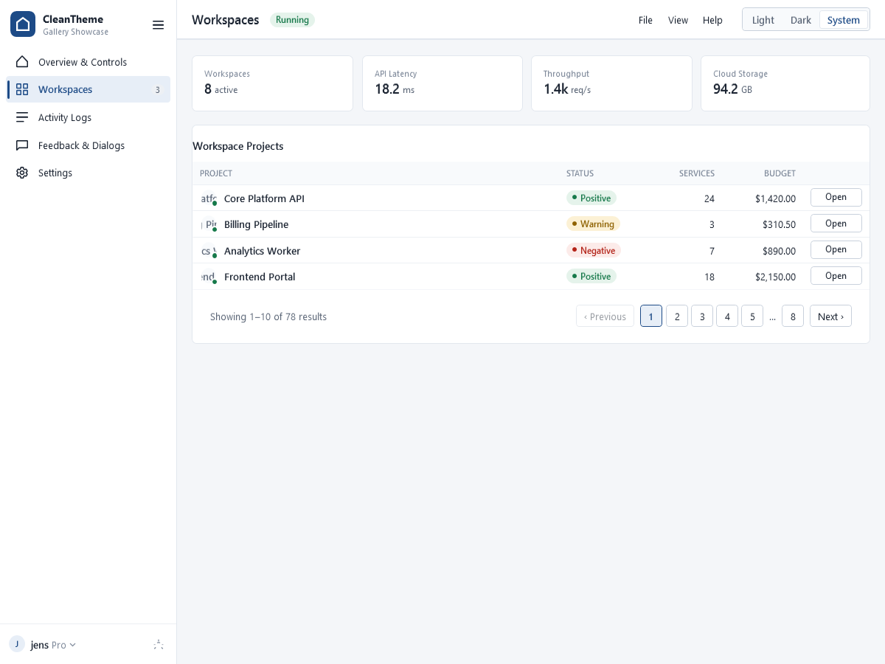
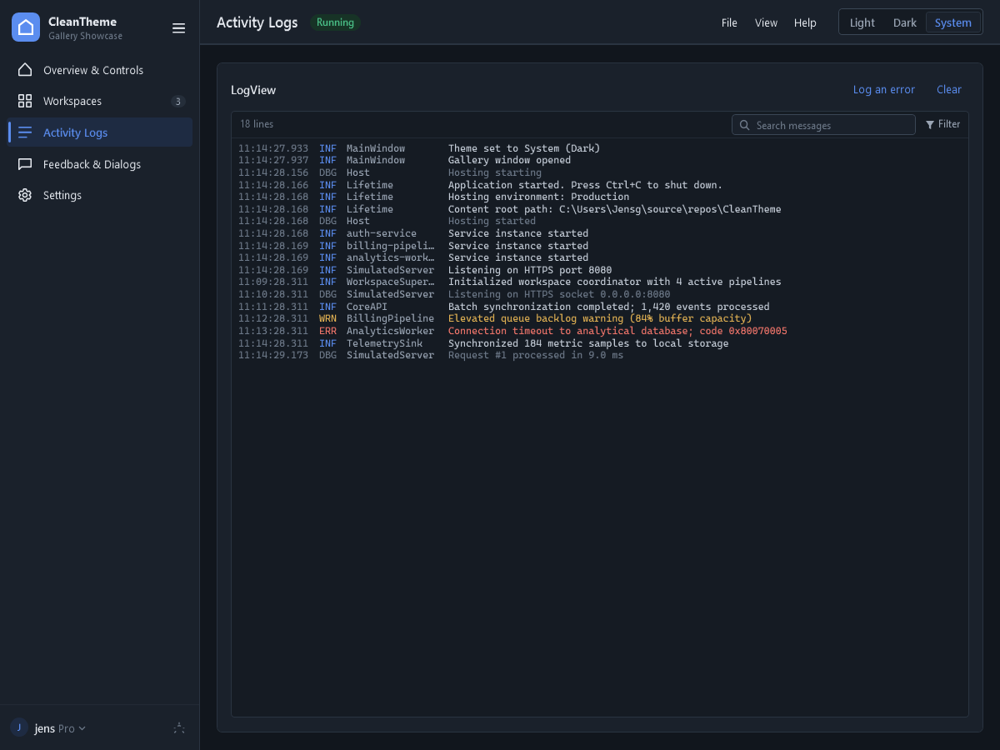

# CleanTheme

A neutral, dense WPF theme with live light and dark modes. One accent for primary actions; green, amber and red only
for status.
Templates stay minimal: controls are restyled with setters wherever the stock template allows it.

Originally the Strato Launcher theme.

<p align="center">
  
  
</p>
<p align="center">
  
  
</p>

| Package | What |
|---|---|
| `CleanTheme.Wpf` | The theme (palette, Untitled UI focus rings, and styles for the stock WPF controls) and controls: `CustomWindow`, `Card`, `StatusPill`, `Avatar`, `AvatarGroup`, `InlineAlert`, `BreadcrumbBar`, `PaginationBar`, `MetricTile`, `SegmentedControl`, `SearchBox`, `ToggleSwitch`, `NumericUpDown`, `EmptyState`, `ToastHost`, `CleanDialog` / `CleanMessageBox`, `HamburgerMenu`, `SearchableSettingsView` |
| `CleanTheme.Logging` | In-app log: an `ILoggerProvider` feeding a bounded, filterable `LogFeed`, and a `LogView` to show it |

## Install

The packages are published to GitHub Packages (`https://nuget.pkg.github.com/jerzky/index.json`), not nuget.org.

```xml
<PackageReference Include="CleanTheme.Wpf" Version="0.6.0" />
<PackageReference Include="CleanTheme.Logging" Version="0.6.0" />
```

## Use the theme

Merge the theme into your **application** resources (context menus and tool tips live outside window trees and find
the palette there):

```xml
<Application xmlns:clean="https://github.com/jerzky/CleanTheme" ...>
    <Application.Resources>
        <ResourceDictionary>
            <ResourceDictionary.MergedDictionaries>
                <clean:CleanThemeResources Mode="System" />
            </ResourceDictionary.MergedDictionaries>
        </ResourceDictionary>
    </Application.Resources>
</Application>
```

Merging `CleanThemeResources.ThemeUri` by `Source` also works, but gives the light palette only, with no switching.

### Windows

Give standard windows the base look:

```xml
<Window ... Style="{StaticResource CleanWindow}">
```

Or use **`CustomWindow`** for modern chromeless windows with custom title bar slots, interactive controls, and native drag/snap behaviors:

```xml
<clean:CustomWindow x:Class="MyApp.MainWindow"
                    xmlns="http://schemas.microsoft.com/winfx/2006/xaml/presentation"
                    xmlns:clean="https://github.com/jerzky/CleanTheme"
                    Title="My Application"
                    Style="{StaticResource {x:Type clean:CustomWindow}}">

    <!-- Center slot: Search bar, command palette (Ctrl+K), or tabs -->
    <clean:CustomWindow.TitleBarContent>
        <TextBox Style="{StaticResource BareTextBox}" Text="Search... (Ctrl+K)" MaxWidth="320" />
    </clean:CustomWindow.TitleBarContent>

    <!-- Right slot: Quick action buttons before minimize/maximize/close -->
    <clean:CustomWindow.TitleBarRightContent>
        <Button Style="{StaticResource GhostButton}" Content="Settings" />
    </clean:CustomWindow.TitleBarRightContent>

    <Grid>
        <!-- App content here -->
    </Grid>
</clean:CustomWindow>
```

```csharp
public partial class MainWindow : CustomWindow
{
    public MainWindow()
    {
        InitializeComponent();
    }
}
```

- **Slots:** `TitleBarLeftContent`, `TitleBarContent` (center), and `TitleBarRightContent`.
- **Automatic Chrome Hit-Testing:** Controls inside slots are automatically clickable and focusable (`WindowChrome.IsHitTestVisibleInChrome="True"`), while empty title bar areas remain draggable with native Aero Snap gestures.
- **Title Visibility:** Set `IsTitleVisible="False"` to hide the window title text in the title bar while preserving `Window.Title` for taskbar and Alt+Tab.

The `https://github.com/jerzky/CleanTheme` XML namespace covers both packages.

## Light and dark

`ThemeManager.Mode` is `Light` (the default), `Dark` or `System` (follows the Windows app-mode setting as it changes).
It is app-wide; set it in XAML on `CleanThemeResources` or from code, from any thread:

```csharp
ThemeManager.Mode = CleanThemeMode.Dark;   // everything recolors live
ThemeManager.ActualModeChanged += ...;     // Light or Dark in effect (raised off the UI thread for System changes)
```

Windows styled with `CleanWindow` (and `CleanDialog`s) get a matching title bar; for other windows set
`clean:WindowTheme.FollowTheme="True"`.

**Reference palette colors with `DynamicResource`** (`Background="{DynamicResource Surface}"`). A `StaticResource`
reads the color once and won't follow a switch. Styles (`{StaticResource PrimaryButton}`) can stay static: their colors
are dynamic inside. Use `AccentFill` / `NegativeFill` with `OnAccent` for solid fills under text; `Accent` and `Negative`
are for text, lines and tints.

## Controls

```xml
<clean:Card Header="Nodes">
    <clean:Card.Actions>
        <Button Content="Clear" Style="{StaticResource GhostButton}" />
    </clean:Card.Actions>
    ...
</clean:Card>

<clean:StatusPill State="Positive" Content="Active" ShowDot="True" />   <!-- Neutral, Info, Positive, Warning, Negative -->
<clean:StatusPill State="Info" Content="Filter" IsClosable="True" />    <!-- Dismissible badge with close button -->

<clean:MetricTile Label="Tick" Value="{Binding TickMs}" Unit="ms" />

<clean:SegmentedControl ItemsSource="{Binding TimeScales}" SelectedItem="{Binding TimeScale}" />

<clean:SearchBox Text="{Binding Filter, UpdateSourceTrigger=PropertyChanged}" Placeholder="Search units" />

<clean:ToggleSwitch Content="Auto-scroll" IsChecked="{Binding AutoScroll}" />

<clean:NumericUpDown Value="{Binding SpeedKts}" Minimum="0" Maximum="900" Increment="10" DecimalPlaces="0" />

<clean:EmptyState Title="No projects found" Description="Create a workspace or import a project to get started." Icon="M 2,6 H 22 V 18 H 2 Z">
    <Button Content="Create project" Style="{StaticResource PrimaryButton}" />
</clean:EmptyState>
```

- `SegmentedControl` is a single-selection `ListBox`; declare literal items as `clean:SegmentedItem`.
- `SearchBox` is a `TextBox` with a magnifier, placeholder and clear button; Escape clears it.
- `NumericUpDown` clamps `Value` to `Minimum`..`Maximum`, rounds to `DecimalPlaces`, and steps by `Increment` with its
  buttons, the arrow keys or the mouse wheel. Typed text commits on Enter or focus loss; invalid text reverts.

**Toasts.** Put a `ToastHost` over the window content (the last child of the root grid; it passes clicks through) and
call `Show` from any thread:

```csharp
toasts.Show("Workspace saved", StatusState.Positive);                         // 4 s
toasts.Show("Connection timeout", StatusState.Negative, TimeSpan.Zero);         // until closed
```

**Dialogs.** `CleanDialog` is a themed window with a heading, the content as body, and primary/secondary buttons
(Enter/Escape); `ShowModal()` returns which one closed it. `CleanMessageBox` has the common cases:

```csharp
CleanMessageBox.Show(owner, "The workspace was saved.", "Workspace");
bool delete = CleanMessageBox.Confirm(owner, "This removes the workspace.", "Delete workspace", "Delete", isDanger: true);
string? name = CleanMessageBox.Prompt(owner, "Save workspace", "Name", "New workspace", "Save");   // null when cancelled
```

**HamburgerMenu.** A collapsible navigation rail and expandable drawer with header (logo), footer (profile button / drop-up menu), and content host:

```xml
<clean:HamburgerMenu SelectedIndex="0" IsPaneOpen="True">
    <clean:HamburgerMenu.Header>
        <Image Source="logo.png" Height="36" />
    </clean:HamburgerMenu.Header>
    <clean:HamburgerMenuItem Icon="M 3,12 L 12,3 L 21,12 V 20 H 3 Z" Text="Overview" />
    <clean:HamburgerMenuItem Icon="..." Text="Workspaces" Badge="14" />
    <clean:HamburgerMenu.Footer>
        <clean:HamburgerProfileButton DisplayName="jens" Subtitle="Pro" Avatar="J">
            <clean:HamburgerProfileButton.ContextMenu>
                <ContextMenu Placement="Top">
                    <MenuItem Header="Settings" InputGestureText="Ctrl+," />
                    <MenuItem Header="Log out" />
                </ContextMenu>
            </clean:HamburgerProfileButton.ContextMenu>
        </clean:HamburgerProfileButton>
    </clean:HamburgerMenu.Footer>
</clean:HamburgerMenu>
```

The menu animates open and close transitions smoothly by default (200 ms cubic ease-out). Customize or disable via `IsPaneAnimated="False"`, `AnimationDuration="0:0:0.150"`, or `AnimationEasing`.

<p align="center">
  
  
</p>

**NavTree & Hierarchical Chat Trees.** A modern hierarchical navigation tree for chat conversations, channels, and workspaces with collapsible groups, chevron expanders, and visual tree branch connector lines (`└──`):

```xml
<clean:NavTree SelectedItem="{Binding SelectedChat}">
    <clean:NavTreeGroup Header="Recent Conversations" IsExpanded="True">
        <clean:NavTreeItem Header="Chat 1: Architecture Review" IsActive="True" IsExpanded="True">
            <clean:NavTreeItem Header="Sub Chat spawned from 1" />
            <clean:NavTreeItem Header="Performance Benchmarks" />
        </clean:NavTreeItem>
        <clean:NavTreeItem Header="Another Chat: Release Planning" />
    </clean:NavTreeGroup>
</clean:NavTree>
```

- **Tree Branch Lines (`└──`)**: Nested sub-items automatically display crisp branch connector guide lines linking back to their parent conversation.
- **Expander Chevrons**: Toggle child visibility via `IsExpanded`, chevron click, row double-click, or Left/Right keyboard arrow navigation.
- **MVVM Hierarchical Binding**: Fully compatible with `HierarchicalDataTemplate` (`ItemsSource="{Binding SubChats}"`).
- **Unified Selection**: Clicking any parent or spawned sub-chat sets `NavTree.SelectedItem` and activates the indicator bar.

**SearchableSettingsView.** A modern settings interface with category tabs, sections, two-column setting rows, and instant live search filtering with `Ctrl+K`:

```xml
<clean:SearchableSettingsView Title="Settings" Description="Manage your team and preferences here.">
    <clean:SettingsCategory Header="My details">
        <clean:SettingsGroup Header="Personal info" Description="Update your personal details here.">
            <clean:SettingsGroup.Actions>
                <Button Content="Save" Style="{StaticResource PrimaryButton}" />
            </clean:SettingsGroup.Actions>

            <clean:SettingRow Header="Name" IsRequired="True">
                <TextBox Text="Jens G" />
            </clean:SettingRow>

            <clean:SettingRow Header="Email address" IsRequired="True" Description="Used for alerts.">
                <TextBox Text="jens@example.com" />
            </clean:SettingRow>

            <clean:SettingRow Header="Two-factor authentication">
                <clean:ToggleSwitch IsChecked="True" Content="Enabled" />
            </clean:SettingRow>
        </clean:SettingsGroup>
    </clean:SettingsCategory>

    <clean:SettingsCategory Header="Notifications" Badge="2">
        ...
    </clean:SettingsCategory>
</clean:SearchableSettingsView>
```

<p align="center">
  
</p>

**Avatars & Groups.** Circular presence avatars and overlapping stacks with automatic `+N` overflow:

```xml
<clean:Avatar Initials="JG" AvatarSize="36" Status="Online" /> <!-- Online, Busy, Away, Offline -->

<clean:AvatarGroup MaxDisplay="3" AvatarSize="34">
    <clean:Avatar Initials="A" />
    <clean:Avatar Initials="B" />
    <clean:Avatar Initials="C" />
    <clean:Avatar Initials="D" />
</clean:AvatarGroup>
```

**InlineAlert.** Semantic inline banner cards with geometric icons, action buttons, and dismiss transitions:

```xml
<clean:InlineAlert State="Positive" Title="Update applied" Message="All cloud worker nodes updated to v10.0." />
<clean:InlineAlert State="Warning" Title="High latency" ActionText="Inspect trace" IsDismissible="True" />
```

**BreadcrumbBar & PaginationBar.** Hierarchy navigation and table pagination controls:

```xml
<clean:BreadcrumbBar>
    <clean:BreadcrumbItem Header="Home" />
    <clean:BreadcrumbItem Header="Workspaces" />
    <clean:BreadcrumbItem Header="Project Settings" />
</clean:BreadcrumbBar>

<clean:PaginationBar TotalPages="8" CurrentPage="1" PageSize="10" TotalItems="78" />
```

The controls carry their own default styles; their colors come from the merged theme.

<p align="center">
  
  
</p>

## Log

The log is an `ILoggerProvider`, so anything that logs through `ILogger` shows up in it. Register it in an
`[STAThread] Main` while building the host (the feed belongs to the UI thread's dispatcher), then resolve the
`LogFeed` singleton for the view:

```csharp
var builder = Host.CreateApplicationBuilder(args);
builder.Logging.AddLogFeed();
builder.Logging.AddFilter<LogFeedLoggerProvider>(null, LogLevel.Information); // or "Logging:LogFeed" in appsettings
```

```xml
<clean:LogView Feed="{Binding Log}" />
```

**Sources.** A `Source` value in a logging scope becomes the line's source, so the popout can narrow to it. The
innermost scope wins, and scopes are shared with the other providers:

```csharp
private static readonly Func<ILogger, string, IDisposable?> UnitScope = LoggerMessage.DefineScope<string>("{Source}");

using (UnitScope(logger, callsign))
{
    LogWaypointReached(logger, waypoint); // Source = callsign
}
// or: logger.BeginScope(new Dictionary<string, object> { ["Source"] = callsign })
```

Lines that don't come from `ILogger` (child process output, for example) can be posted directly, from any thread:

```csharp
feed.Post(new LogEntry(DateTime.UtcNow, LogLevel.Information, Source: "UAV-1", Message: "Process started"));
```

- Each `ILogger` line keeps its category, level, rendered message and exception (appended to the message). Event ids
  and structured state are not kept.
- `LogFeed` keeps the newest `Capacity` lines (default 2000). `SourceFilter`, `CategoryFilter`, `MinimumLevel` and
  `TextFilter` hide lines without dropping them; `Sources` and `Categories` list what has been seen; `ResetFilters()`
  clears them all. It raises `PropertyChanged`, so filters can be bound. `Post` is thread-safe and batches onto the
  dispatcher; everything else is UI-thread only.
- `LogView` shows time, level, origin (the source, else the short category such as `NodeSupervisor`; hide with
  `ShowOrigin="False"`) and message, colors the level, virtualizes, follows new lines while scrolled to the bottom, and
  holds still once you scroll up. Its top bar shows the line count ("120 of 340 lines" while filtered) and a **Filter**
  popout with level, source and category filters; the button turns navy while a filter is on. Hide the
  bar with `ShowFilterBar="False"`.
- The top bar also has a search box (the feed's `TextFilter`). When no line is visible, the view says so, and offers
  "Reset filters" when filters are the reason.
- `LogView` is a `ListBox`: select lines with click, Shift/Ctrl-click, drag or Ctrl+A, and copy them with Ctrl+C or the
  right-click menu (Copy, Copy all lines, Select all). Copies are plain text in display order, one `LogEntry.Text` per
  line (time, level, origin, message, stack trace).

The gallery sample is set up this way: a Generic Host whose hosted services log through `ILogger`, one of them per
unit inside a `Source` scope.

## What's in the theme

| Kind | Keys |
|---|---|
| Surfaces | `AppBackground`, `Surface`, `SurfaceSunken`, `Hover`, `Pressed`, `Border`, `BorderStrong`, `Divider` |
| Text | `Text`, `TextMuted`, `TextSubtle`, `TextLog`, `UiFont`, `MonoFont` |
| Accent | `Accent` (text/lines), `AccentFill` + `AccentHover` + `AccentPressed` (solid fills), `AccentSoft`, `OnAccent` |
| Status | `Positive(Soft)`, `Warning(Soft)`, `Negative(Soft)`, `NegativeFill` + `NegativeHover` + `NegativePressed`, `NegativeBorder`, `NeutralSoft` |
| Tool tips | `ToolTipBackground`, `ToolTipText` |
| Text styles | `CardTitle`, `FieldLabel`, `MetricLabel`, `MetricValue` |
| Containers | `CleanWindow`, `Card`, `Pill` (style keys for plain `Border`s; the controls above are the richer option) |
| Buttons | implicit `Button`, `PrimaryButton`, `DangerButton`, `GhostButton`, `RowButton`, `SegmentButton` (for `ToggleButton` / `RadioButton`, highlights on `IsChecked`) |
| Inputs | implicit `TextBox`, `ComboBox`, `ComboBoxItem`; `NumericTextBox` |
| Tables | implicit `DataGrid`, `DataGridColumnHeader`, `DataGridRow`, `DataGridCell`; `NumericHeader`, `NumericCell` |
| Scrolling | implicit `ScrollBar` (thin, rounded thumb with a minimum length, no arrows) and `ScrollViewer` |
| Choices | implicit `CheckBox` (incl. three-state), `RadioButton`, `Slider`, `ProgressBar` (incl. indeterminate) |
| Lists and trees | implicit `ListBox` / `ListBoxItem`, `TreeView` / `TreeViewItem`, `Separator` |
| Layout | implicit `TabControl` / `TabItem` (tabs on top), `Expander` |
| Menus | implicit `Menu`, `MenuItem` (menu bars, submenus, check marks, gestures) and `ContextMenu`; also keyed as `CleanContextMenu` / `CleanMenuItem` |
| Dates | implicit `DatePicker` and `Calendar` |
| Tool tips | implicit `ToolTip` (dark, rounded) |
| Buttons (more) | `DangerPrimaryButton` (solid red, for confirming destructive actions) |
| Log | `LogList` (monospace `ListBox`) |

Palette keys live in `Themes/Palette.Light.xaml` and `Themes/Palette.Dark.xaml`, which must define the same keys (a
test checks this, and the text contrast in both). Resource keys are public API: renaming or removing one is a breaking
change.

## Develop

```bash
dotnet build CleanTheme.slnx
dotnet test CleanTheme.slnx
dotnet run --project samples/CleanTheme.Gallery
```

The gallery shows every style and control on one page, with a live log.

## Release

Versions come from git tags through MinVer. Pushing a tag such as `v0.6.0` runs `publish.yml`, which builds, tests,
packs and pushes both packages to GitHub Packages.
